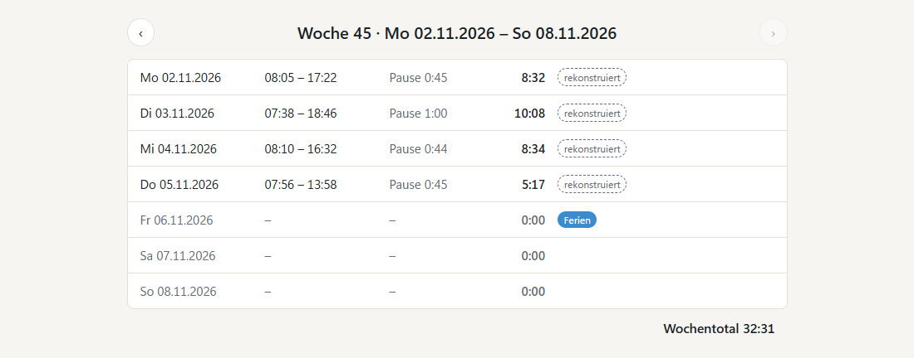
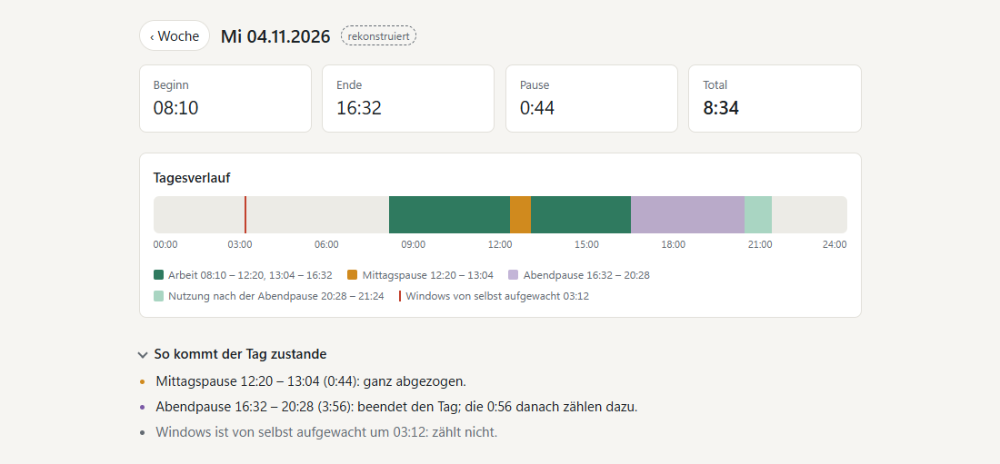
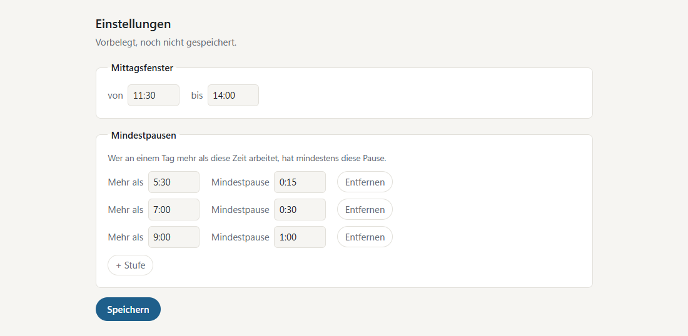
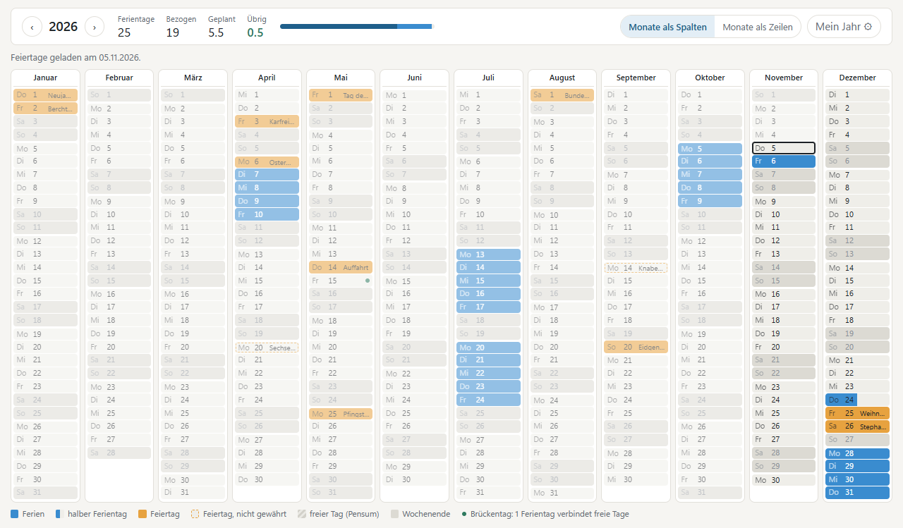
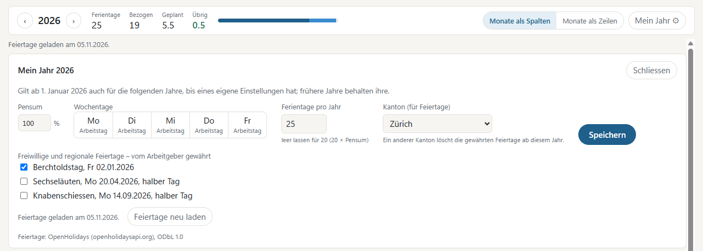

# Work Time Tracker

Works out your working time from when you use your Windows 11 laptop: each day's start, end, lunch break
and total, and each week's total, ready for your timesheet. A year planner books your holidays around your
canton's public holidays.

There is nothing to start or stop. A small background program, started at sign-in, notes each lock and unlock,
and the app works out the days from that. The screens are in German; the labels quoted below are the ones you
will see. The screenshots show invented data.

## The week



The app opens on the current week («Woche»). Each day from Monday to Sunday shows when work started and ended,
the break deducted («Pause») and the total; below them is the week total («Wochentotal»). The arrows step back
through earlier weeks.

- **The days before you installed are already there.** The app reads your laptop's own sign-in, lock and sleep
  history, as far back as Windows keeps it: typically weeks to months, depending on the laptop.
- **Those days are marked «rekonstruiert»**, because Windows' history is less precise than live recording. The
  same mark shows on any day with a gap the app filled from that history.
- **Copy it as it stands.** The times are what you type into your timesheet; nothing needs adding up.

## The day



Click a day to open it. It shows the day's start, end, break and total, and a 24-hour timeline: your work in whole
blocks, the lunch pause, the evening pause and the time after it, and the moments Windows woke up by itself.
«So kommt der Tag zustande» explains how the day's numbers came about.

How a day is counted:

- **From first to last use.** Your use starts when you unlock or sign in and ends when you lock, the laptop goes
  to sleep, or you sign out or shut down. Everything between the day's start and end is work, except the pauses
  below.
- **Lunch.** The longest pause that starts inside your lunch window is your lunch pause, and all of it is deducted,
  even if it runs past the end of the window. If it is shorter than the minimum break for the length of your day,
  or there is none, the minimum is deducted instead. A pause that starts before the window opens is never lunch.
- **Other pauses count as work.** A coffee break or a locked screen during a meeting is part of your working time
  when it lies outside the lunch window.
- **A long pause late in the day ends it.** If your last pause lasts 2 hours or more and is not your lunch pause, the
  day ends where that pause begins. Coming back in the evening adds only the minutes you work then, not the whole evening.
- **Work past midnight** counts up to 24:00 on the first day and goes on from 00:00 the next. If you come back
  less than an hour after stopping late at night, the gap still counts as work; the night's sleep after that
  does not.
- **Windows waking up by itself never counts.** Updates and maintenance wake many laptops at night; without an
  unlock, a sign-in or your own input, nothing is counted.

## Recording status

The top right of the window always says whether the background program is recording and when it last recorded
(«Aufzeichnung läuft · zuletzt …»), or since when it has been stopped («Aufzeichnung gestoppt seit …»). Opening
the app starts it again if it has stopped. The time it missed is filled from Windows' history and marked
«rekonstruiert».

## Lunch and break settings



Under «Einstellungen» you set the window in which your lunch pause starts («Mittagsfenster») and your minimum
breaks («Mindestpausen»): a day where you work more than a given time has at least that break. Add or remove a step
with «+ Stufe» and «Entfernen». This is the only setup the time tracking needs, and it comes prefilled:

| Lunch window | Minimum breaks |
|--------------|----------------|
| 11:30–14:00  | more than 5:30 → 0:15 · more than 7:00 → 0:30 · more than 9:00 → 1:00 |

- A saved change applies from the day you save it («Gilt ab …»); earlier days keep the rule they had, so weeks
  you have already typed into your timesheet stay as they were.
- Your first save also applies to the days from before you installed. The days between installing and that first
  save keep the prefilled rule.
- An entry that doesn't make sense, such as a window that ends before it starts, is refused with the reason and
  nothing is saved.

## The year planner



«Ferien» shows the whole year on one screen, months as columns or as rows («Monate als Spalten», «Monate als
Zeilen»); the app remembers your choice.

- **Drag to book.** Drag across the days you want off: every working day in that stretch is booked, while
  weekends, public holidays and free weekdays stay as they are. A drag that starts on a booked day removes the bookings instead.
- **Click to book one day.** A click turns a day into a holiday, a second click into a half day, a third clears it.
  With the keyboard, Tab and the arrow keys move between days, and Enter or Space does what a click does.
- **Undo** («Rückgängig») takes back your last change.
- **The counts are always in view:** your holiday days for the year («Ferientage»), the days taken before today
  («Bezogen»), the days planned from today on («Geplant») and what is left («Übrig»). They change live while
  you drag. Left can go below zero.
- **Your canton's public holidays** appear by themselves, with their names in the days, and cannot be booked. Optional and regional ones, such as Berchtoldstag or Sechseläuten in Zürich, count only once you
  have ticked them in «Mein Jahr». Where a public holiday is a half day, the other half can be booked.
- **Bridge days are marked:** a single working day between two days off, at least one of them a public
  holiday, so one holiday day joins them up.
- Past days are dimmed and today is outlined. The arrows next to the year switch to earlier years and to next year.
- The public holidays are loaded for last, this and next year. The line below the counts says when they were
  loaded («Feiertage geladen am …»), or that they are not loaded yet and why; the planner still works, and the
  counts follow once they arrive. If the source has corrected its data, «Feiertage neu laden» in «Mein Jahr»
  loads them again.

## «Mein Jahr»



«Mein Jahr», at the top right of the planner, holds what the planner needs to know about your year:

- **Pensum** — your work percentage.
- **Weekdays** — each one a working day or free («Arbeitstag», «frei»). Free weekdays are striped in the
  planner and cannot be booked.
- **Holiday days per year** («Ferientage pro Jahr») — leave it empty for 20 × your Pensum, rounded to the
  nearest half day (16 at 80 %).
- **Canton** — whose public holidays count.
- **Optional and regional public holidays** — tick the ones your employer grants.

Your settings apply to the whole year from 1 January, and carry into the following years until you save other
settings for one of them; earlier years keep theirs. The ticks start empty in each new year, and choosing another canton clears them.
A booking on a day that later becomes a day off stays in the plan but counts 0 until the day is a working day
again. The source of the public holidays and its licence are named at the bottom.

## Holidays in the week

The week view marks each day as it counts, next to its times: «Ferien», «½ Ferien», «Feiertag» or «½ Feiertag»
with the holiday's name, and «frei» for a free weekday. The marks never change a day's times or totals. A booking
on a day that is already off gets no mark, and a week of a year whose public holidays are not loaded shows only
your bookings and free days.

## Privacy

- Your times stay on your laptop, in your own profile (`%LocalAppData%\WorkTimeTracker`), readable only by
  you. Uninstalling removes them.
- The app sends nothing about you. Its only request fetches your canton's public holidays for a year from
  [OpenHolidays](https://www.openholidaysapi.org). The Microsoft Edge WebView2 runtime that draws its screens
  makes its own update, time and configuration checks to Microsoft.
- No account, no telemetry, no update code: updates come through winget.

## Install

```powershell
winget install Valem.WorkTimeTracker
```

Installs per user, without admin rights. Update with `winget upgrade Valem.WorkTimeTracker`; remove with
`winget uninstall Valem.WorkTimeTracker`, which removes your data too.

## Before you rely on it

> **Please bear with it.** This is a personal project, tested on one setup only. A day may come out wrong, or the
> app may not run on your laptop at all. Check the times against your own memory before you hand in a timesheet,
> and if something is off, please open an issue with your Windows version (Settings > System > About). It comes
> without warranty (see the licence).

- **Tested only on Windows 11 Pro, version 25H2 (build 26200), x64**, on one laptop and in Windows Sandbox on the
  same build, with the WebView2 runtime 156. Other editions, versions or builds, other hardware, and company
  setups with other policies may log your use differently or block the app.
- **German screens, Swiss formats and cantons** only.
- **Lock your screen when you leave** (Win+L): on many laptops a screen that just turns off counts as in
  use until the laptop locks.
- The installer is **not code-signed** yet; Windows may warn when you run it directly.

## Build from source

Needs the .NET 10 SDK, Node.js 24 and PowerShell 7.

```powershell
pwsh tools/verify.ps1     # build, tests, UI type check, hygiene
pwsh tools/run.ps1        # build and start the app
```

## Contributing

Bug reports and ideas are welcome as GitHub issues. Please open an issue before a pull request, so we can
agree on the change first. A pull request must pass `pwsh tools/verify.ps1`.

Never attach real usage data or Windows event-log exports to an issue: they show when you work. Describe the
times instead, or invent them.

## Licence

[MIT](LICENSE). Public-holiday data © OpenHolidays contributors,
[ODbL 1.0](https://github.com/openpotato/openholidaysapi.data).
