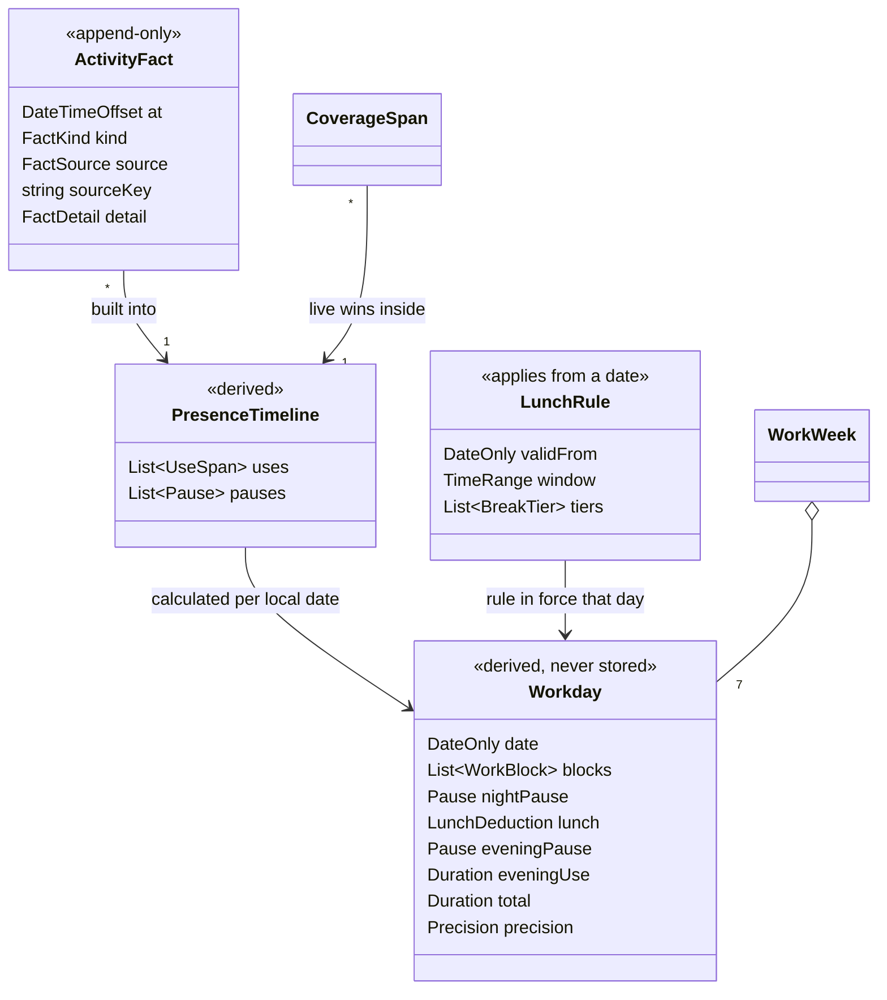
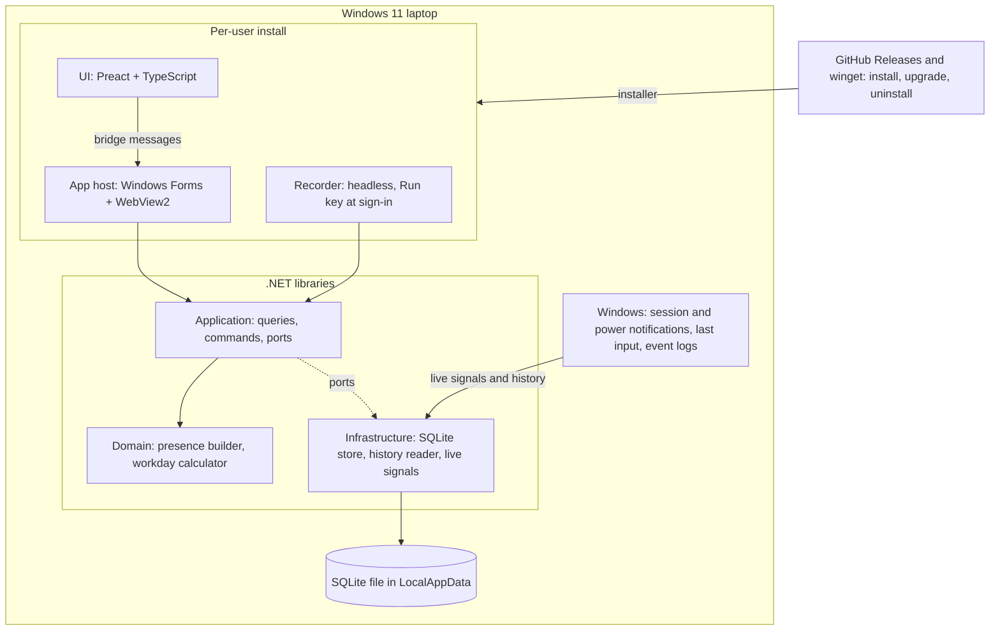
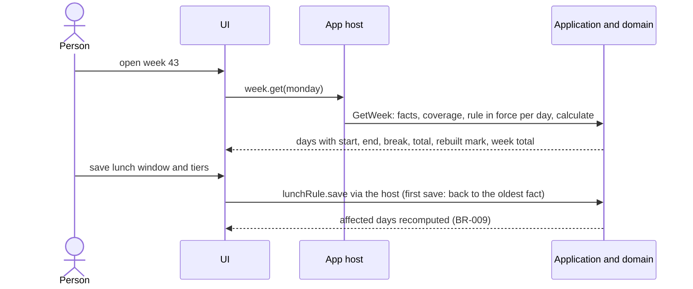

# Foundation — Technical Concept

**Version:** v1.5.1 · **Feature:** 001-foundation · **Brief:** [brief.md](brief.md) v1.4.0 (approved) · **Vision:** [vision.md](../../vision.md) v1.3.0

## 1. Executive Context

* **Goal:** A per-user Recorder notes when the person uses the laptop, Windows' history fills the days before install and any gap, and a pure domain core
  derives every workday and week from those facts. An app shows week, day and lunch settings; one winget command installs it; nothing is sent anywhere.
* **Series carried without redesign:** 002 corrections + non-work days, 003 overtime balance, 004
  holiday planner — each adds inputs beside the facts and screens; Recorder and facts stay untouched.

### Use Case Inventory

| UC | Actor | Goal | Outcomes |
|----|-------|------|----------|
| UC-001 | Person | Install with winget, open once, optionally adjust lunch window and break tiers | 1 |
| UC-002 | Recorder (system) | Record the person's use without any action, across restarts and standby | 2, 6 |
| UC-003 | Recorder (system) | Rebuild days from Windows history on first start and after recording gaps | 5 |
| UC-004 | Person | Read off a day or a week for the timesheet | 1, 4 |
| UC-005 | Person | Change the lunch window or tiers | 3 |

### Functional Requirements & Technical Solutions

| FR | Description | Technical Solution |
|----|-------------|--------------------|
| FR-001 | Record the person's use of the laptop automatically, across restarts, standby and sign-outs (outcomes 2, 6) | Recorder started at sign-in; session/power notifications, last input, idle timeout; facts + coverage (ADR-002, ADR-003) |
| FR-002 | Rebuild past days from what Windows keeps, on first start and after any recording gap; such days are marked less precise (outcome 5, K1) | Idempotent import of Winlogon 811 and System events at every Recorder start and on detected gaps (ADR-003) |
| FR-003 | Work out each day's start, end, lunch deduction and total, with the midnight split and a long last pause ending the day; Windows waking itself never counts (outcomes 2, 3, 8) | Pure domain core: presence timeline → workday calculator, BR-001…BR-012 |
| FR-004 | Show a Monday-start week (each day's start, end, break, total, week total) and a day timeline that explains ignored Windows wakes and the lunch deduction (outcomes 1, 4, A1) | Preact UI in WebView2 over the bridge (ADR-006) |
| FR-005 | Lunch window and minimum-break tiers, prefilled (P1) — the only setup (outcomes 1, 3, K4) | Lunch rules with the date they apply from (ADR-004, BR-009) |
| FR-006 | Show whether recording runs and when it last recorded (K2) | App reads the latest coverage span |
| NFR-001 | No process of the app opens a network connection — WebView2 children and crash reporting included — except the WebView2 runtime's own update and time checks to Microsoft (outcome 7) | — |
| NFR-002 | Data lives only in the person's local, non-roaming profile, readable by them only, kept until uninstall (vision limit, K3) | — |
| NFR-003 | The Recorder never keeps the laptop awake and averages < 0.5 % CPU (outcome 6) | — |
| NFR-004 | Installs and upgrades per user with one winget command, without admin rights; the app holds no update code (vision) | — |

### Business Rules

| BR | Rule |
|----|------|
| BR-001 | **Use starts at an unlock or a sign-in** — or, where the session resumes without a lock screen, at the first real input after resume if the laptop then stays awake and unlocked more than 2 minutes. Real input in an unlocked session extends use. Beyond the Winlogon log (~7 weeks), a standby exit with a person reason (input, fingerprint, power button, lid) counts as an unlock only under the same 2-minute test |
| BR-002 | **Windows waking itself never counts:** a wake with no unlock, sign-in or qualifying input before the next standby produces no use |
| BR-003 | **A use span ends** at a lock, standby, sign-out or shutdown; each live end fact stores its cause. Live: an end caused by a timer (idle lock, screen-saver lock, display-off standby, machine inactivity limit) falls at the later of the last real input and the event's time minus the timer that fired; lid, power button, Win+L, sign-out, shutdown and a cause this version does not know end at their own time. History: at the event's time, marked approximate; a boot that finds use still open ends it at the stop time Windows logs for the unexpected shutdown (event 6008), else at the last fact before the boot. Idle time without a lock stays use |
| BR-004 | **Sources:** inside the Recorder's coverage only live facts count; outside it, history facts — and only those inside this user's own sign-in sessions. Exception (BR-011): the stretch from sign-in to the Recorder's start is filled from history inside coverage |
| BR-005 | **Day and midnight split:** start = first use, end = last use of the local date at the UTC offset stored with each fact, or the start of the evening pause (BR-012). A span crossing 00:00 is the day's last use up to 24:00 and continues the next day from 00:00. Everything between start and end is work except the night pause and lunch |
| BR-006 | **Night pause** — only on a day that begins with use carried over midnight, i.e. its first use starts less than 60 minutes after the previous day's last use (a span crossing 00:00 is the zero-minute case); then the pause around 00:00 is work, the previous day's last use runs to 24:00 and this day starts at 00:00, and the longest pause after 00:00 that ends before the lunch window opens — when none does, the longest that starts before it — is not work. On every other day the first use starts the day, as the last use or the evening pause ends it |
| BR-007 | **Lunch:** a pause is the whole gap between two use spans, whatever lies inside (lock, standby, Windows wakes, off). The longest pause touching the lunch window, other than the night pause, is the lunch pause and is deducted whole — raised to the tier minimum when shorter |
| BR-008 | **Tier minimum (net):** attendance = end − start − night pause + evening use (BR-012); the break is the smallest value ≥ the lunch pause such that the tier for (attendance − break) is ≤ the break; total = attendance − break. A tier applies when its threshold is strictly exceeded. With the same pauses, more attendance never lowers the total |
| BR-009 | **Rule in force:** until the first save, every day — before and after install — uses the prefilled rule (P1); then the days before install use the last rule saved on the first save's day, the days from install to that day keep the prefilled rule, and each saved rule applies from its own date until the next (K4) |
| BR-010 | **Week:** Monday to Sunday; week total = sum of the day totals |
| BR-011 | **Precision:** a day whose use comes partly from history outside coverage is marked rebuilt (K1) — except the stretch from sign-in to the Recorder's start when the Recorder starts within 5 minutes of the sign-in, filled from history unmarked |
| BR-012 | **Evening pause:** the day's last pause, when it lasts 2 h or more and is neither the lunch pause nor the night pause, ends the day where it starts; the time from its end to the end of the last use — 24:00 when that use runs past midnight (BR-005, BR-006) — is evening use and adds only its own minutes. A last pause ending before the lunch window opens is a morning pause and stays work. A last pause of 1:59 changes nothing |

### Traceability Matrix

| Phase | FR | UC | BR |
|-------|----|----|----|
| Phase-1 | FR-002, FR-003 | UC-003 | BR-001…BR-011 |
| Phase-2 | FR-001, FR-002, FR-003 | UC-002, UC-003 | BR-001…BR-008, BR-012 |
| Phase-3 | FR-004, FR-005, FR-006 | UC-001, UC-004, UC-005 | BR-009, BR-010, BR-011 |
| Phase-4 | FR-001, FR-004 | UC-001 | — |

## 2. Architecture Decision Records (ADRs)

All are project-wide (`docs/decisions/`), none feature-only. **Owner** = hard to undo, cost or security: the owner's at the gate.

**ADR-001** [Stack](../../decisions/ADR-001-stack.md) — .NET 10 LTS C#, Windows Forms host with WebView2. **Owner** (web UI chosen).\
**ADR-002** [Distribution](../../decisions/ADR-002-distribution.md) — per-user Inno Setup installer on GitHub Releases, listed in winget's community repository; Recorder autostart by the per-user `Run` key; unsigned at first; per-machine install as AppLocker fallback. **Owner** (channel and fallback decided; fallback used only where a target laptop's evidence shows a block; unsigned means Smart App Control blocks it until signed; an enforced Defender ASR prevalence rule may block each new release until it gains reputation or IT excludes it, which signing does not settle).\
**ADR-003** [Activity source](../../decisions/ADR-003-activity-source.md) — live Recorder first, Windows history second, live wins inside coverage.\
**ADR-004** [Data store](../../decisions/ADR-004-data-store.md) — one SQLite file in `%LocalAppData%`; facts stored, days derived; a rule fix may change past weeks. **Owner** (decided).\
**ADR-005** [CI](../../decisions/ADR-005-ci.md) — public GitHub repository, GitHub Actions; verify = build, one test per business rule, the architecture test, hygiene check; synthetic fixtures only in git. **Owner** (decided).\
**ADR-006** [Web UI](../../decisions/ADR-006-web-ui.md) — Preact + TypeScript (Vite), JSON message bridge, locked-down WebView2, local crash reports, silence measured. **Owner** (fallback is the owner's if silence fails).

## 3. Static Architecture

### Domain Model



Value types: `at` = the instant with the UTC offset in force · `FactKind` = Unlock, Lock, SignIn, SignOut, StandbyEnter, StandbyExit, Boot, Shutdown,
LastInput, IdleTimeout · `FactSource` = Live, WinlogonHistory, SystemHistory · `FactDetail` (end cause, timer, reason name, raw reason as Windows gave it,
session), stored as JSON · `CoverageSpan` (from, to) · `WorkWeek` (monday, days, total) · `UseSpan` (start, end, precision) · `Pause`
(start, end, ignored wakes) · `BreakTier` (over, minimum) · `LunchDeduction` (pause, deducted, basis).\
**Invariants:** the fact journal is append-only and deduplicated by `sourceKey`; only the Recorder writes live facts; stored facts are never rewritten.
Infrastructure names a reason from its stored raw reason with the current mapping when facts are read (ADR-004), so a reason named later (fingerprint)
reaches facts already stored; domain rules decide on reason names only, and the raw reason passes through the domain unread; a name or cause it does not know reads as unknown, never as an error. Lunch rules are superseded, never edited. Workdays
and weeks are a pure function of facts, coverage and the rules in force — recomputed on read, never stored. The Recorder knows nothing
about days; Recorder and App meet only in the database. Domain depends on nothing; application declares ports that infrastructure implements;
Domain and Application reference neither Windows nor I/O — the architecture test enforces this view, with negative probes. 002–004 add `DayCorrection`, `DayMark`, dated `TargetHours` beside facts.

### Component Diagram



### Solution Structure

```text
src/
├── Wtt.Domain/          # facts, presence, workday rules — no Windows, no I/O
├── Wtt.Application/     # queries, commands, ports (journal, coverage, history, cursor, rules)
├── Wtt.Infrastructure/  # SQLite store, event-log history reader, live session/power/input signals
├── Wtt.Recorder/        # headless per-user process (Run key)
├── Wtt.App/             # Windows Forms host, WebView2, bridge
├── Wtt.Cli/             # self-contained CLI printing weeks, own data file; not installed
└── ui/                  # Preact + TypeScript (Vite)
installer/               # Inno Setup script, winget manifest template
tests/                   # Wtt.Rules.Tests: one test per business rule · Wtt.Architecture.Tests: the dependency view
tools/                   # verify.ps1, check-hygiene.ps1, wtt-check.ps1, run.ps1
```

## 4. Behavioral Specification

### UC-001 and UC-003 — first start, history rebuild, recording gaps

```mermaid
sequenceDiagram
  actor P as Person
  participant A as App
  participant R as Recorder
  participant W as Windows
  participant D as Data file
  P->>A: winget install, open once
  A->>R: launch (the Run key starts it at every later sign-in)
  R->>W: session logon time; Winlogon 811 and System events since cursor
  W-->>R: ~7 weeks lock/unlock, ~3 months power events
  R->>D: facts of this user's sessions (deduplicated), cursor, coverage from sign-in
  A->>D: read facts, coverage, rule in force (prefilled)
  A-->>P: today and past weeks, rebuilt days marked
  Note over R,D: after any gap (crash, upgrade, Run entry off) the next start imports since cursor; filled spans are marked rebuilt
```

### UC-002 — recording a day, Windows' own wakes ignored

```mermaid
sequenceDiagram
  participant W as Windows
  participant R as Recorder
  participant D as Data file
  W->>R: sign-in 08:10 (Run key), unlock 08:12
  R->>D: SignIn 08:10 (logon time), Unlock; coverage from 08:10, extended every minute
  W->>R: lock 17:32 (idle timeout 5 min)
  R->>W: last input time?
  W-->>R: 17:26
  R->>D: LastInput 17:26, Lock 17:32, cause idle timer 5 min (use ends 17:27, BR-003)
  W->>R: suspend, resume 03:10 (Windows wake, no unlock, no input)
  R->>D: StandbyExit fact only, no use (BR-002)
  W->>R: unlock 08:05 next day
  R->>D: Unlock fact, use starts (BR-001)
```

### UC-004 and UC-005 — reading a week, changing lunch settings



## 5. Interfaces & Contracts

### Bridge messages (UI ↔ App host, ADR-006)

```text
week.get        { monday }         → days (start, end, break, total, rebuilt) + week total
day.get         { date }           → blocks, pauses, night pause, lunch pause and basis, ignored wakes, rebuilt
status.get      { }                → recording running?, last recorded instant
lunchRule.get   { }                → rule in force today, prefilled or saved
lunchRule.save  { window, tiers }  → saved rule and the date it applies from
data.changed    (host → UI event)  → new facts recorded; the UI refreshes the visible view
```

### Service Interfaces

```csharp
public interface IFactJournal { Task<int> AppendAsync(IReadOnlyList<ActivityFact> facts); Task<IReadOnlyList<ActivityFact>> ReadAsync(Interval range); Task<DateTimeOffset?> EarliestAsync(FactSource? source = null); }   // Append returns how many were new
public interface ICoverageLog { Task<DateTimeOffset> BeginAsync(DateTimeOffset signedInAt); Task ExtendAsync(DateTimeOffset now); Task ResumeAsync(DateTimeOffset suspendedAt, DateTimeOffset resumedAt); Task<IReadOnlyList<CoverageSpan>> ReadAsync(Interval range); }   // Begin returns the coverage start: the sign-in after an autostart within 5 min, else now; Resume bridges a standby whose start and end the Recorder saw
public interface IHistorySource { Task<HistoryBatch> ReadSinceAsync(HistoryCursor cursor, UserSid user); }   // facts + next cursor (time, session open then)
public interface IHistoryCursorStore { Task<HistoryCursor> LoadAsync(); Task SaveAsync(HistoryCursor cursor); }
public interface ILunchRules { Task<LunchRule> InForceOnAsync(DateOnly date); Task<LunchRule> SaveAsync(TimeRange window, IReadOnlyList<BreakTier> tiers); }
public interface IPresenceBuilder { PresenceTimeline Build(Interval range, IReadOnlyList<ActivityFact> facts, IReadOnlyList<CoverageSpan> coverage, DateTimeOffset? winlogonHistoryFrom); }
public interface IWorkdayCalculator { Workday Calculate(DateOnly date, PresenceTimeline presence, LunchRule rule); }
public interface IWorkTimeQueries { Task<WorkWeek> GetWeekAsync(DateOnly monday); Task<Workday> GetDayAsync(DateOnly date); Task<RecordingStatus> GetRecordingStatusAsync(); }
```

## 6. Implementation Strategy

**Verify command:** `pwsh tools/verify.ps1` — .NET build (warnings as errors) → `dotnet test`: one test per business rule and the architecture test → hygiene check; Phase-3 adds the UI's type check (ADR-005).
No other tests: the QA live check proves every AC on real runs of the built programs, synthetic history replayed through the product's own importer where a scenario needs one; an AC tracing to a BR also cites the verify output.
Named in `CLAUDE.md`, run by CI on every push and pull request. ≤ 2 review rounds per phase. ACs use window 12:00–13:30 and tiers over 5:30 → 0:15, over 7:00 → 0:30, over 9:00 → 1:00. Installed-build ACs run where unsigned executables run.
Development runs through the signed `dotnet` host; Smart App Control is never turned off. On a company-managed laptop, Defender attack-surface-reduction rules can block an unsigned executable run from removable media, so hands-on checks there run a build made from source on that laptop.

### Cross-cutting concerns

| # | Concern | Answer |
|---|---------|--------|
| 1, 2 | Repository, CI/CD | Phase-1 — §3 structure, .NET 10, package source pinned to nuget.org; verify on every push and PR; Node LTS joins with the UI in Phase-3. Phase-4 — release on tag (ADR-005) |
| 3–5, 13 | IaC, identity, auth, cutover | Out of scope — no cloud, no accounts, greenfield; the profile's access rights protect the file |
| 6, 7, 12 | Health, observability, operations | Phase-2 — coverage spans, Run key, App and installer restart a stopped Recorder, gaps filled from history; errors-only log in the data folder, capped at 1 MB, never sent. Phase-3 shows status (FR-006) |
| 8, 9 | Config, data, migrations | Phase-1 — lunch rules in the data file, no secrets; forward-only migrations at open (ADR-004) |
| 10, 11 | Integration, tests | Windows notifications and event logs, read-only (ADR-003). Tests: one per business rule and the architecture test, in verify. Everything else is proven by the QA live check: built programs on a real laptop, scripted protocols, synthetic Windows event XML replayed through the product's own importer |
| 14 | Network silence, power | Phase-2 probe, Phase-3 and Phase-4 24 h runs and forced crashes (NFR-001); Phase-2 power (NFR-003) |

### Human dependencies

| Dependency | Who | Gates |
|------------|-----|-------|
| Target-laptop evidence, `tools/wtt-check.ps1` output: Smart App Control, AppLocker/WDAC, winget, sign-in after sleep — also decides the per-machine fallback (ADR-002) | Owner | Phase-2 (per-user install there) |
| .NET 10 SDK and PowerShell 7 on each machine that builds; PowerShell 7 installs without admin rights as a .NET global tool (`dotnet tool install --global PowerShell`) | Owner | Every build |
| Windows Sandbox enabled on the development laptop (for `SandboxTest.ps1`) | Owner | Phase-2 |
| A GitHub account to submit to `microsoft/winget-pkgs` | Owner | Phase-4 |
| One colleague willing to install with winget | Owner | Phase-4 |

### Phase 1: Truth from history

**Goal:** The domain core, with every rule, turns Windows history into correct past days and weeks, stored as facts — the riskiest premise first.\
**Stop point:** The target laptop's past weeks print and match memory and timesheets — or the rules change before anything is built on them.\
**Rides along:** repository, solution, CI verify, `CLAUDE.md`, synthetic fixtures, the self-contained CLI.\
**Milestone:** M1 — on the target laptop the owner checks the printed weeks against memory and timesheets, with the CLI built from source on that laptop: `dotnet publish src/Wtt.Cli -c Release -r win-x64 -o artifacts\cli`, then `.\artifacts\cli\wtt-cli.exe weeks`. Phase-2 waits until they have.\
**Scope:** domain core facts → presence → workday → week; idempotent history import (Winlogon 811, System events) of this user's sessions with a time cursor; lunch rules with prefilled defaults.\
**Constraints:** domain and application reference no Windows API and no I/O (ADR-001); real event-log exports stay git-ignored, CI runs synthetic fixtures only (ADR-005).\
**References:** ADR-001 (stack), ADR-003 (activity source), ADR-004 (store), ADR-005 (CI) · FR-002 (rebuild history), FR-003 (derive workday), UC-003, BR-001 to BR-011

**Acceptance Criteria:**

| AC | Criteria | Traces To |
|----|----------|-----------|
| AC-1.1 | Mon unlock 22:00, Tue lock 00:40, Windows wake 03:10–03:11 without unlock, unlock 08:15, lock 12:00–12:45, lock 17:00 → Tuesday blocks 00:00–00:40 and 08:15–17:00, night pause 00:40–08:15, lunch 0:45, total 8:40; Monday's last block ends 24:00. Wed last lock 23:50, Thu unlock 00:10–00:40, then the same day → Wednesday ends 24:00 (+0:10); Thursday blocks 00:00–00:40 and 08:15–17:00, night pause 00:40–08:15, total 8:40 | FR-003, BR-002, BR-005, BR-006 |
| AC-1.2 | Day 08:00–17:00 with lock 12:00, standby 12:05, Windows wake 12:30–12:32, unlock 13:00 → one pause 1:00, total 8:00; with lock 11:50–12:40 instead → 0:50 deducted whole, total 8:10 | FR-003, BR-007 |
| AC-1.3 | Without a pause: 08:00–13:45 → 5:30 · 08:00–17:00 → 8:30 · 08:00–17:01 → 8:31 · 08:00–17:45 → 9:00 · 08:00–18:31 → 9:31 | FR-003, BR-008 |
| AC-1.4 | Unlock 05:00–05:05, then 08:00–17:00 with lock 12:15–12:45, no midnight work → start 05:00, no night pause, break 1:00 (tier), total 11:00; 08:00–17:00 with locks 10:00–10:20 and 12:15–12:45 → the coffee pause is work, total 8:30 | FR-003, BR-006, BR-008 |
| AC-1.5 | A synthetic night with 20 standby exits ("Input Keyboard", "Power Button") and no unlock → 0 of them start or extend use; the day starts at the first unlock | FR-003, BR-001, BR-002 |
| AC-1.6 | Beyond Winlogon coverage: a person-reason standby exit followed by 2:01 awake starts use; one back in standby after 1:59 does not | FR-002, BR-001 |
| AC-1.7 | On the target laptop, over the weeks where Winlogon and System records overlap, the start found by the 2-minute test lies within ± 5 min of the unlock-based start on ≥ 90 % of workdays (CLI report; the share is shown at the gate) | FR-002, BR-001 |
| AC-1.8 | Inside coverage, idle timeout 10 min, lock 12:08: last input 11:58 → pause starts 11:58; last input 11:00 (display held on) → pause starts 11:58. The same lock outside coverage → pause starts 12:08, day marked rebuilt | FR-003, BR-003, BR-004, BR-011 |
| AC-1.9 | Unlock 08:00, lock 17:00 local on 2026-10-25 and 2027-03-28 (DST) → 9:00 attendance each; facts recorded at UTC+1 keep their dates after the time zone changes to UTC−5 | FR-003, BR-005 |
| AC-1.10 | Installed Mon 2026-10-12: before any save every day uses the prefilled rule; a first rule saved Mon 2026-10-19 changes a rebuilt day of 2026-09-21 and the days from 10-19 on, while 10-12…10-18 keep the prefilled result | FR-005, BR-009 |
| AC-1.13 | After that, a second rule saved Wed 2026-10-21 changes Wed–Sun of week 43 only; days before 10-21 keep their results | FR-003, BR-009 |
| AC-1.11 | Week of Mon 2026-10-19 lists Monday→Sunday; the week total equals the sum of the day totals | FR-003, BR-010 |
| AC-1.12 | Importing twice, or again after the log was cleared, adds no duplicate; another user's sessions on the same laptop add nothing; the CLI prints every day from the oldest retained event to today | FR-002, BR-004, UC-003 |

### Phase 2: Live recording, installed per user

**Goal:** Today is recorded live within one minute by a Recorder that starts at every sign-in from a per-user install; the installer and its winget manifest are proven early — the riskiest outside premise; the M1 rules (evening pause, fingerprint wake) make past and present days right.\
**Stop point:** Recording the owner can rely on, evenings and fingerprint wakes counted as decided at M1, before there is a real UI.\
**Rides along:** Inno Setup installer, winget manifest checked early (`winget validate`, winget-pkgs `Tools/SandboxTest.ps1`, Defender scan), `tools/run.ps1`, App host with a placeholder page (to measure WebView2 early), coverage heartbeat, catch-up import, errors-only log; the evening pause and the fingerprint wake — domain rules provable alone on synthetic days, too small for a stop point of their own.\
**Scope:** Recorder capture of session, logon time, power, last input and idle timeout; coverage from sign-in and across a standby the Recorder saw begin and end (TD-002); import on start and on gap; stored facts readable whatever names another version wrote (TD-003, fingerprint); install, upgrade-in-place and uninstall; App host starting a stopped Recorder; BR-012 and BR-001's fingerprint reason in the domain core.\
**Constraints:** the Recorder holds no power request (NFR-003) and writes facts only — no day logic outside the domain core (ADR-003); stored facts are never rewritten, infrastructure names reasons on read with the current mapping (ADR-004); the default per-user path needs no admin rights (ADR-002). Residual risk: winget-pkgs' antivirus "Installers Scan" may flag an unsigned autostarting executable — mitigation: SignPath signing (owner).\
**References:** ADR-002 (distribution), ADR-003 (activity source), ADR-004 (store), ADR-006 (web UI) · FR-001 (record use), FR-002 (rebuild history), FR-003 (derive workday), UC-002, UC-003, BR-001, BR-002, BR-003, BR-004, BR-005, BR-006, BR-007, BR-008, BR-012

**Acceptance Criteria:**

| AC | Criteria | Traces To |
|----|----------|-----------|
| AC-2.1 | Over 5 scripted workdays, recorded start = first unlock ± 60 s and end = last real input ± 60 s against a hand log, one end by idle auto-lock; a 45-minute lock at lunch is a 45 ± 1 minute pause | FR-001, BR-003 |
| AC-2.2 | A video holds the display on for 30 min without input, then the idle lock comes → use ends at lock time − idle timeout ± 60 s; the lid closed after 30 min of video without input → use ends at lid time ± 60 s | FR-001, BR-003 |
| AC-2.3 | After a cold boot the day is not marked rebuilt, its start = sign-in ± 60 s and its coverage begins at sign-in, the stretch until the Recorder started filled from history; a day with a standby at lunch is not marked rebuilt; after restart, sign-out/in and overnight standby, coverage resumes from sign-in without any action | FR-001, UC-002, BR-004, BR-011 |
| AC-2.4 | With "require sign-in after sleep: never": standby at lunch, then input → use restarts at the first input ± 60 s; overnight Windows wakes add no use; `powercfg /requests` never lists the Recorder; its CPU averages < 0.5 % over 4 h awake | FR-001, BR-001, BR-002 |
| AC-2.5 | Recorder stopped for 30 minutes with a lock and an unlock inside → on its next start the gap is filled from history and that day is marked rebuilt; a stop during continuous use leaves the day as recorded | FR-002, BR-004 |
| AC-2.6 | `winget validate` passes; `Tools/SandboxTest.ps1` installs the manifest in Windows Sandbox; a Defender scan of the installed folder finds nothing; `wtt-setup.exe /VERYSILENT /CURRENTUSER` installs without admin rights or a UAC prompt; upgrading in place keeps the facts; uninstalling removes the program, the `Run` value and the data folder (K3) | FR-001, UC-002 |
| AC-2.7 | WebView2 open on the placeholder for 4 h awake → no outbound connection from the app's process tree but the runtime's own update and time checks (NFR-001 probe); a second standard user account is denied opening the data file (NFR-002) | FR-001, UC-002 |
| AC-2.8 | Unlock 08:00, lock 12:00–13:00, lock 17:30, unlock 22:40, shutdown 22:42 → start 08:00, end 17:30, break 1:00, total 8:32; the same visit at 19:30–19:32 (last pause 2:00) → end 17:30, total 8:32; at 19:29–19:31 (last pause 1:59) → end 19:31, total 10:31 | FR-003, BR-005, BR-012 |
| AC-2.9 | Unlock 08:00, lock 12:15–15:00, lock 17:00 → the last pause touches the lunch window and is the lunch pause: end 17:00, break 2:45, total 6:15 | FR-003, BR-007, BR-012 |
| AC-2.10 | Unlock 08:00, lock 15:00 → break 0:15, total 6:45; with a visit 20:00–20:20 added → end 15:00, break 0:20, total 7:00 (the evening minutes count toward the tier) | FR-003, BR-008, BR-012 |
| AC-2.11 | Mon unlock 08:00, lock 12:00–12:30, lock 17:00, unlock 23:30, Tue lock 00:20, unlock 08:00, lock 12:00–12:30, lock 16:00 → Monday end 17:00, break 0:30, total 9:00; Tuesday starts 00:00, night pause 00:20–08:00, break 0:30, total 7:50. The same with a Mon lock 23:50 and Tue unlock 00:10 → the same two days | FR-003, BR-005, BR-006, BR-012 |
| AC-2.12 | Beyond Winlogon coverage, a standby exit with Kernel-Power reason 44 (fingerprint) followed by 2:01 awake starts use; one back in standby after 1:59 does not; a data file holding such an exit as `Unmapped:KernelPower 44` from an earlier version gives the same days, its stored fact unchanged. A history day with use 08:00–12:00 and 13:00–17:30 from person-reason exits, then a reason-44 exit at 22:40 and a shutdown at 22:43 → end 17:30, total 8:33, marked rebuilt; shutdown at 22:42 → total 8:30 | FR-002, BR-001, BR-012 |
| AC-2.13 | A stored end whose cause this version does not know (written by a newer Recorder) reads as unknown and ends use at its own time; the weeks still print | FR-001, BR-003 |

### Phase 3: The app

**Goal:** Week view, day timeline and lunch settings run in WebView2 on live and rebuilt data, with the recording status shown and the whole app proven silent, crashes included.\
**Stop point:** The owner reads off a real week from the app they use every day.\
**Rides along:** the UI's type check in verify, prefilled settings (P1).\
**Milestone:** M2 — on the target laptop the owner installs the local build and uses it for a working week: `.\wtt-setup.exe /VERYSILENT /CURRENTUSER`. Phase-4 waits until they have.\
**Scope:** the screens — week, day timeline with ignored wakes and lunch explanation (A1), settings with tiers; the bridge (§5); recording status; web-view lockdown and local crash reports (ADR-006).\
**Constraints:** the UI computes nothing; every number comes from the domain core over the bridge.\
**References:** ADR-001 (stack), ADR-004 (store), ADR-006 (web UI) · FR-004 (day/week view), FR-005 (lunch settings), FR-006 (recording status), UC-001, UC-004, UC-005, BR-009, BR-010, BR-011

**Acceptance Criteria:**

| AC | Criteria | Traces To |
|----|----------|-----------|
| AC-3.1 | Every week shown equals the CLI's output for that week, day by day (start, end, break, total, rebuilt mark, week total) | FR-004, BR-010, BR-011 |
| AC-3.2 | The days of AC-1.1 and AC-1.2 show the ignored Windows wakes and say which pause was deducted and whether the tier raised it | FR-004, UC-004 |
| AC-3.3 | On a fresh Windows user account, after install and with no setup, today and the past days show under the prefilled rule; settings hold only lunch window and tiers; a save recomputes the days of BR-009 | FR-005, UC-001, BR-009 |
| AC-3.4 | The status shows the last recorded time within 2 minutes; with the Recorder stopped it shows "not recording since …" within 2 minutes | FR-006, UC-004 |
| AC-3.5 | 24 h with every screen used, and forced crashes of host, Recorder and renderer: no outbound connection from the app's process tree but NFR-001's exception, no queued Windows Error Report; a navigation to an outside URL is refused | FR-004, UC-004 |

### Phase 4: Ship through winget

**Goal:** A tagged release lands on GitHub and in winget's community repository; a colleague installs it with one command and sees their days without help; upgrades keep the data.\
**Stop point:** Release candidate installable with `winget install`.\
**Rides along:** release workflow, winget submission, README install line.\
**Milestone:** M3 — the owner installs the published release on the target laptop: `winget install <id>`. The done gate follows.\
**Scope:** tag-built release, winget-pkgs submission and validation, install, upgrade and uninstall from the published package.\
**Constraints:** no update or network code in the app (ADR-002); the release is built by CI from a tag (ADR-005).\
**References:** ADR-002 (distribution), ADR-005 (CI) · FR-001 (record use), FR-004 (day/week view), UC-001

**Acceptance Criteria:**

| AC | Criteria | Traces To |
|----|----------|-----------|
| AC-4.1 | A version tag publishes installer and CLI with SHA-256 hashes on a GitHub Release; the winget-pkgs pull request passes validation and is merged | FR-001, UC-001 |
| AC-4.2 | A colleague runs `winget install <id>` without admin rights and sees today and past days without asking anyone | FR-004, UC-001 |
| AC-4.3 | `winget upgrade` to a later release keeps all facts, and the Recorder runs again within 60 s | FR-001, UC-001 |
| AC-4.4 | 24 h on the published build: no outbound connection from the app's process tree but NFR-001's exception | FR-001, UC-001 |

## 7. Agent-introduced in this version

| # | Item | Why | From | Decision |
|---|------|-----|------|----------|
| K1 | Days rebuilt from Windows history are marked less precise | History cannot reach ±1 minute | competing designs A, B, C | Keep (owner) |
| K2 | The app shows whether recording runs and when it last recorded | A stopped Recorder would silently lose days | A, B, C | Keep (owner) |
| K3 | Raw activity times kept on the laptop until uninstall | Days recompute from them; 002–004 build on them | A, B, C | Keep (owner) |
| K4 | Lunch-settings changes apply from that day on; past days keep their rule | Weeks already typed in must not shift | A, B, C | Keep (owner) |
| C1 | Local diagnostic log as a user-facing item | Kept only as mechanism: errors only, capped, never sent (§6 rows 6, 7, 12) | A | Cut (coordinator) |
| C2 | Uninstall asks whether to keep the data | Not part of the brief | A | Cut (coordinator) |
| C3 | Colleagues' event-log exports as test corpus | Their usage times would leave their laptops | B | Cut (coordinator) |
| P1 | Prefilled settings: lunch window 11:30–14:00 and the brief's example tiers | A fresh install shows today's day before any setup | concept v1.0.0 | Keep (owner) |
| A1 | The day view explains ignored Windows wakes and the lunch deduction | The person can see why a day reads as it does | prototype, review r1 | Keep (owner) |
| F1 | Freeze past weeks against rule fixes in updates | Typed-in weeks would never shift | review r1 | Cut (owner) |
| B1 | Midnight bridge: work is carried over midnight when the first use after it comes less than 60 min after the last use before it; the pause between counts as work | A 23:50 lock and 00:10 unlock must not start a new day at 00:10 | coordinator, review r2 | Keep (owner) |
| E1 | Evening pause: a last pause of 2 h or more ends the day; use after it adds only its own minutes (BR-012) | Short evening visits (wake or unlock, then shutdown) turned whole evenings into work | M1, owner | Keep (owner) |
| W1 | A fingerprint wake counts as a person, like keyboard and mouse (BR-001) | Windows logs it under a reason code of its own, so it never counted | M1 check (QA) | Keep (owner) |
| E2 | The day view shows the evening pause and the minutes after it | A total above end − start − break is otherwise unexplained | concept v1.3.0 | Keep (owner) |
| S1 | A Start-menu shortcut opens the app | The way a person finds the app (UC-001) | Phase-2 installer | Keep (owner) |
| S2 | An "Open Work Time Tracker" tick box ends an interactive install | Opens the app right away; silent installs skip it | Phase-2 installer | Keep (owner) |
| S3 | The Recorder starts right after install and upgrade | Recording begins the same day, not at the next sign-in | Phase-2 installer | Keep (owner) |
| S4 | The winget listing's description text | Public text a colleague reads before installing | Phase-2 winget template | Keep (owner) |
