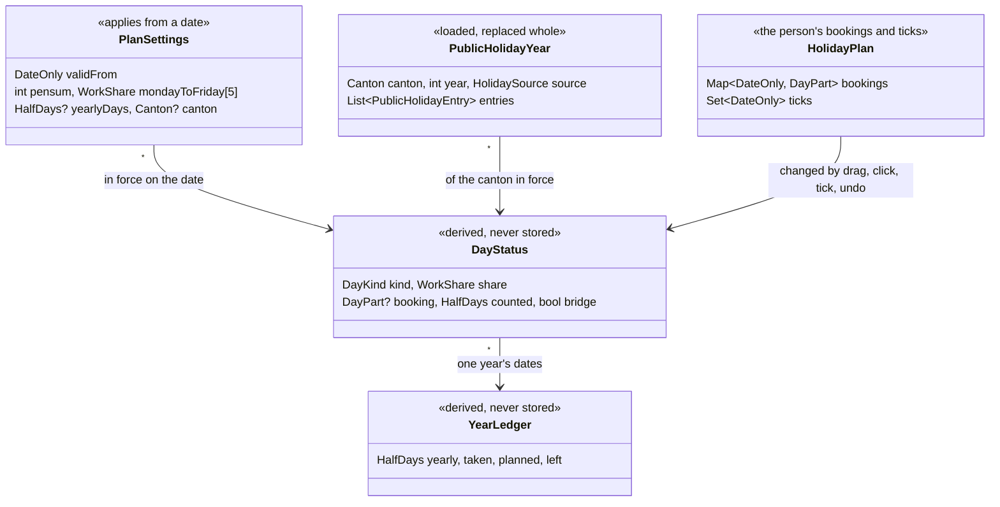
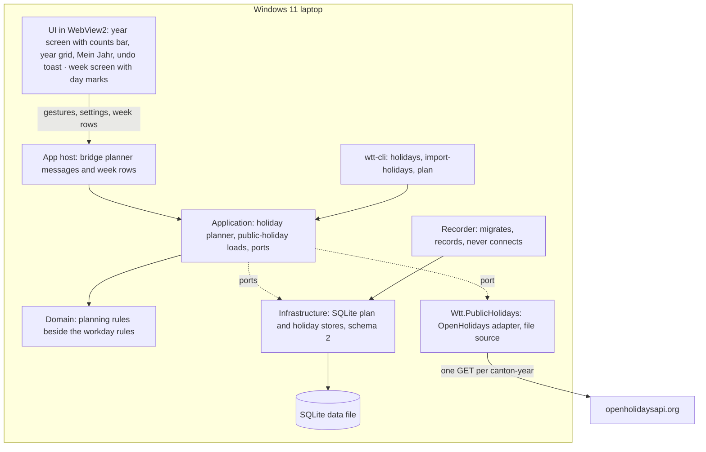
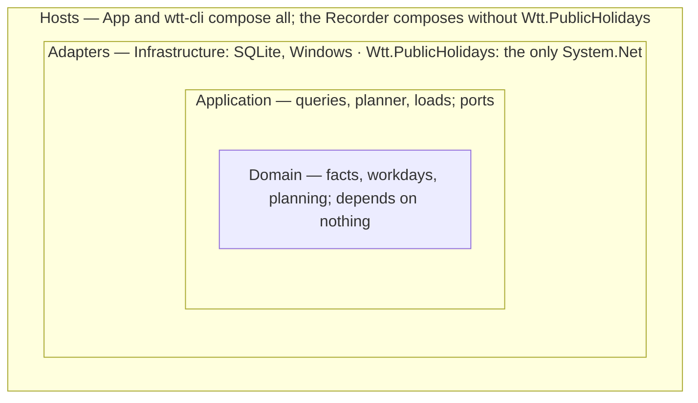
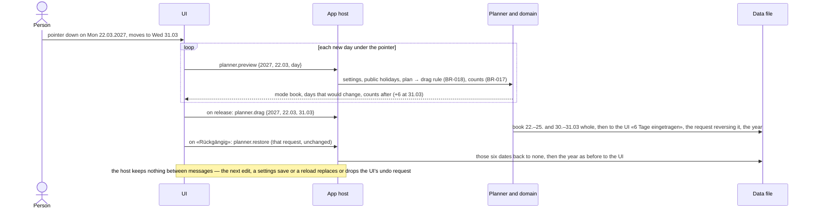
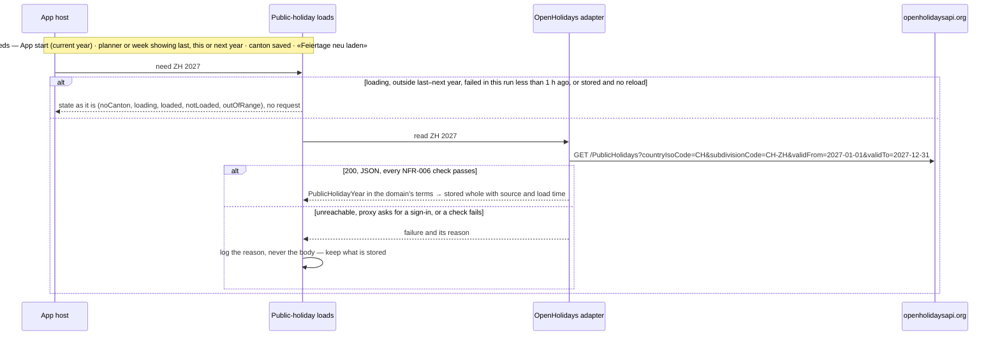
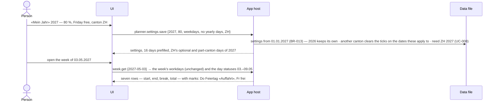

# Holiday Planner — Technical Concept

**Version:** v1.1.0 · **Feature:** 002-holiday-planner · **Brief:** [brief.md](brief.md) v1.0.0 (approved) · **Vision:** [vision.md](../../vision.md) v1.4.0 · **Builds on:** [001 concept](../001-foundation/concept.md) v1.6.0

## 1. Executive Context

* **Goal:** A year planner in the existing app: the person sets «Mein Jahr» once, drags the year's holidays onto the calendar and moves them as plans change; the canton's public holidays
  arrive by one request per canton and year. The person's inputs are stored, every day's status and count is derived by the domain core, and the week shows each day's marks beside its unchanged times.
* **Built for the next changes:** another public-holiday source or format is one adapter; a half free day (90 %), further years and a second language change no model, store or contract, and a
  canton move during a year no model or store — work shares count in half days, settings apply from a date, and the source's names are kept in every language it gives.

### Use Case Inventory

| UC | Actor | Goal | Outcomes |
|----|-------|------|----------|
| UC-006 | Person | Plan the year: drag to book or remove days, click a day whole → half → none, undo the last change, read the counts | 1, 2, 5 |
| UC-007 | Person | Set up «Mein Jahr»: Pensum, free weekdays, yearly holiday days, canton, granted optional public holidays | 2, 3 |
| UC-008 | App (system) | Load the canton's public holidays of a year once; keep working without them | 3 |
| UC-009 | Person | Read the week with each day's holiday marks | 4 |

### Functional Requirements & Technical Solutions

| FR | Description | Technical Solution |
|----|-------------|--------------------|
| FR-007 | The whole year on one screen, months as columns or rows as chosen; drag over free days books them, over holiday days removes them; a click goes whole → half → none, and the keyboard reaches each day and does the same; the last change can be undone; yearly, taken, planned and left always in view and live while dragging; bridge days marked, past days dimmed, today outlined, public-holiday names in the cells; a switch to past years and next year (outcomes 1, 2, 5; H1–H4, H7, H10, H16–H18, H20) | Preact year screen over the bridge; the UI sends gestures, the domain decides; a preview message carries the live counts (ADR-009) |
| FR-008 | «Mein Jahr»: Pensum, each weekday working or free, yearly holiday days prefilled 20 × Pensum, canton, ticks for granted optional public holidays; it carries into the next year with the ticks empty, and a change applies to the whole planned year while earlier years keep theirs; a booking on a day that becomes a day off stays and counts 0 (H5, H11–H13) | Dated plan settings and per-day bookings (ADR-008, BR-013, BR-016) |
| FR-009 | The canton's public holidays of a year appear without any entry; optional and part-canton ones count once ticked; a half public holiday leaves half a day bookable; the planner says whether they are loaded and works without them; «Feiertage neu laden» on request; the source and its licence named (outcome 3; H6, H8, H9, H14) | Neutral port, OpenHolidays adapter in `Wtt.PublicHolidays`, requested by the App host (ADR-007) |
| FR-010 | The week marks holiday, half holiday, public holiday, half public holiday and free day — as they count — beside each day's unchanged times (outcome 4; H19) | Week rows carry the domain's day marks (§5) |
| NFR-001 | **(amended)** No process of the app opens a network connection — WebView2 children and crash reporting included — except the WebView2 runtime's own update and time checks to Microsoft, and the App host's public-holiday request (owner): the DNS lookup of `openholidaysapi.org` and `GET https://openholidaysapi.org/PublicHolidays?countryIsoCode=CH&subdivisionCode=CH-<canton>&validFrom=<year>-01-01&validTo=<year>-12-31` with `Accept: application/json` and no other header, cookie or credential, direct or through the system proxy, with what Windows fetches to find that proxy; Windows checks the certificate's chain, name and expiry without a revocation fetch. The App sends it only while it runs and after a canton is chosen: once per canton and year for last, this and next year when not stored; once per click on «Feiertage neu laden», none while that canton-year is loading; after a failure, once more at the next App start or at a need at least 1 h later. The developer CLI's `holidays` command, run by hand, sends the same request. The Recorder opens no connection | — |
| NFR-005 | **(extended)** Each locale also supplies the month names, the 26 canton names, the planner's texts and marks, one text per new refusal code and load-state reason, the source's attribution and the half-day format (16.5); public-holiday names come from the source in the active language, else German | — |
| NFR-006 | The public-holiday response is untrusted: HTTPS with the runtime's default certificate check (chain, name, expiry; no revocation fetch); no redirect, no decompression; at most 256 KiB within 15 s; required fields read strictly, extra fields ignored; every date inside the requested year, an entry at most 7 days long, at most 100 entries, every entry reaching the country or the requested canton, at least one public holiday reaching the country or the canton, each name at most 100 characters without control or direction-override characters. It is stored only whole and valid, in the domain's terms, never as the raw body; otherwise the stored year stays and the reason — never the body — goes to the error log | — |
| NFR-007 | A drag's preview answers within 100 ms for 95 % of the days the pointer reaches, on the target laptop | — |

### Business Rules

| BR | Rule |
|----|------|
| BR-013 | **Settings in force:** on a date, the «Mein Jahr» settings with the latest start on or before it apply; of several with one start, the last saved. Settings saved for a year start on its 1 January and so carry into later years until one has its own. Before any save: 100 %, Monday–Friday working, yearly days prefilled, no canton. Saving another canton clears the ticks on the dates those settings apply to |
| BR-014 | **Public holiday that counts:** a holiday of kind *public* reaching the whole country or the whole canton in force counts by itself; any other — optional, reaching only part of the canton, or of a kind not known — counts only once ticked |
| BR-015 | **Work share:** a date's work share is its weekday's share in the settings in force — none on Saturday and Sunday — less the share of a public holiday that counts on it, never below none. Only a date with a share above none can be booked |
| BR-016 | **Counted booking:** a whole booking counts 1, a half 0.5, never more than the date's work share; on a date with no work share it counts 0 and stays booked |
| BR-017 | **Year counts:** yearly days = the yearly days in force on 1 January, else 20 × the Pensum in force then, to the nearest half day; taken = counted days of the year before today; planned = counted days from today on; left = yearly − taken − planned, negative allowed |
| BR-018 | **Drag:** a drag covers the dates from its anchor to its end, both included. When the anchor's booking counts, it removes the bookings on the bookable dates; otherwise it books every bookable date whole. Dates that cannot be booked keep what they hold |
| BR-019 | **Click:** on a date with an optional or part-canton public holiday and no counting booking, a click ticks or unticks it. On a bookable date it goes none → whole → half → none; where the work share is a half, none → half → none, a whole booking going to none. Anywhere else it changes nothing |
| BR-020 | **Bridge day:** a bookable, unbooked date of whole work share whose two neighbours both have no work share, at least one of them because of a public holiday that counts |

### Traceability Matrix

| Phase | FR | UC | BR |
|-------|----|----|----|
| Phase-1 | FR-007, FR-008, FR-009 | UC-006, UC-007, UC-008 | BR-013…BR-020 |
| Phase-2 | FR-007, FR-008, FR-009, FR-010 | UC-006, UC-007, UC-008, UC-009 | BR-013, BR-015, BR-016, BR-017, BR-018, BR-019 |
| Phase-3 | FR-007, FR-009, FR-010 | UC-008 | — |

## 2. Architecture Decision Records (ADRs)

Project-wide ones live in `docs/decisions/`. **Owner** = hard to undo, cost or security: the owner's at the gate.

**ADR-001** [Stack](../../decisions/ADR-001-stack.md) — unchanged stack; `Wtt.PublicHolidays` is a plain `net10.0` library on the runtime's HTTP and JSON, no new package. Amended.\
**ADR-002** [Distribution](../../decisions/ADR-002-distribution.md) — unchanged channel; no update code, and the only network code is ADR-007's request, sent by the App host and, run by hand, wtt-cli's `holidays`. Amended.\
**ADR-004** [Data store](../../decisions/ADR-004-data-store.md) — schema 2 adds the plan's tables; the Recorder migrates; forward-only. Amended.\
**ADR-005** [CI](../../decisions/ADR-005-ci.md) — unchanged verify; 20 rule tests and the architecture test, which now denies `System.Net` to every project but `Wtt.PublicHolidays`.\
**ADR-006** [Web UI](../../decisions/ADR-006-web-ui.md) — CSP stays `'self'`; the page never connects; drags are pointer events. Amended.\
**ADR-007** [Public holidays](../../decisions/ADR-007-public-holidays.md) — OpenHolidays behind a neutral port, requested by the App host and by wtt-cli's `holidays` run by hand, hardened, stored normalized. **Owner** (an outside party without SLA; NFR-001's exception; the App host as sender; no proxy credentials; no revocation fetch — decided).\
**ADR-008** [Plan data](../../decisions/ADR-008-plan-data.md) — inputs stored, days and counts derived; bookings per day; settings dated; half days as the unit. **Owner** (forward-only schema 2).

### ADR-009: Planner gestures go to the domain; the UI keeps only the last undo request (feature only)

**Context:** The UI computes nothing (001), yet a drag shows its effect on the counts while the pointer moves, and changes are undoable (brief outcome 1); the owner cut undo beyond the last change (H15).\
**Decision:** The UI posts gestures — a drag's anchor and end, a clicked date, a tick — and the domain decides the mode, the bookable days, the click cycle and the counts (BR-017…BR-019).
`planner.preview` answers each new day under the pointer, the latest answer shown. Each edit answers with the request that reverses it; the UI keeps the last one and sends it back unchanged;
the host keeps nothing between messages. Drags are pointer events within the page; each day is a button the keyboard reaches; one year grid lays the same days out as columns or rows.\
**Rejected alternatives:** per-day values summed in the UI — it would compute counts and repeat the bookable rule · an undo stack in the host — state between messages, for an undo the owner
cut to the last change · year snapshots in the UI — the UI would hold plan state · HTML drag and drop — made for moving objects, with drop targets the lockdown keeps closed.\
**Consequences:** one bridge round trip per day the pointer reaches (NFR-007); an undo writes exactly the before-state it carries — after a settings change a restored booking on a day now off counts 0 (BR-016).

## 3. Static Architecture

### Domain Model



Value types: `WorkShare` = none, half, whole · `DayPart` = whole, half · `HalfDays` = whole half days (33 = 16.5 days) · `Canton` = the 26 cantons ·
`PublicHolidayEntry` = date, share, kind (public, optional, other), reach (country, canton, part of the canton), names by language · `DayKind` = workday,
weekend, free day, public holiday · `PlanChange` = the bookings and ticks a gesture changes, before and after; its inverse is the undo request.\
**Invariants:** a booking is the person's intent and changes only by a drag, a click or an undo; settings are superseded, never edited; a public-holiday
year holds only dates of its year, at most 100 entries and at least one public holiday reaching the country or the canton. `DayStatus` and `YearLedger`
are pure functions of settings, public-holiday years, plan and today's date. `Workday` and `WorkWeek` are untouched: a day's marks never change its times.

### Component Diagram



### Dependency View



Infrastructure and `Wtt.PublicHolidays` implement Application's ports and never reference each other. The architecture test keeps 001's view and adds `Wtt.PublicHolidays` (referencing
Application and Domain; referenced by App and wtt-cli, never the Recorder); it denies `System.Net` to every project but `Wtt.PublicHolidays` and admits `System.Threading.CancellationToken`
and `System.Threading.Lock` in Application — each with a negative probe.

### Solution Structure

001's tree, plus `src/Wtt.PublicHolidays/` (the OpenHolidays adapter and the file source for wtt-cli, `net10.0`). Planning lives beside the workdays in `Wtt.Domain` and `Wtt.Application`,
the plan and public-holiday stores in `Wtt.Infrastructure`, the year screen and «Mein Jahr» in `src/ui`, and BR-013…BR-020's tests in `tests/Wtt.Rules.Tests`.

## 4. Behavioral Specification

### UC-006 — drag with live counts, then undo the last change



### UC-008 — loading a canton's public holidays



### UC-007 and UC-009 — «Mein Jahr», then the week with its marks



## 5. Interfaces & Contracts

### Bridge messages (UI ↔ App host, ADR-006, ADR-009)

```text
planner.year.get      { year? }               → the year (none: the current one), previous and next year (null at the switch's ends), today, the layout, counts (yearly, taken,
                                                planned, left; taken and planned also in ‰ of yearly), the load state (noCanton, loading, loaded with its date, notLoaded with its reason:
                                                unreachable, proxySignIn, invalid; outOfRange), 12 months, each with its days: date and weekday, kind, work share, booking, counted half
                                                days, public holiday (names in the active language, counts, offered or ticked, share), bridge, past, today
planner.preview       { year, anchor, to }    → mode (book or erase), the days that would change with their new booking, counts after, change in half days
planner.drag          { year, anchor, to }    → an edit: what changed (booked or removed, from, to, half days), the request that reverses it, the year
planner.click         { year, date }          → an edit (booked whole, booked half, removed, ticked, unticked — or nothing changed)
planner.tick          { year, date, ticked }  → an edit («Mein Jahr»'s tick box)
planner.restore       { year, days, ticks }   → the year — the reversing request of the last edit, sent back unchanged
planner.settings.get  { year }                → Pensum, Monday–Friday each working or free, yearly days or the prefilled value, canton, the year's optional and part-canton holidays with date, names and tick, the load state, the source and its licence
planner.settings.save { year, pensum, weekdays, yearlyDays?, canton? } → as settings.get, or a refusal (nothing saved)
planner.reload        { year }                → the load state once its one request has ended; no request while that canton-year is loading
planner.layout.save   { layout }              → the layout (columns or rows)
week.get              (changed)               each day row also carries the marks of what counts: holiday, halfHoliday, publicHoliday, halfPublicHoliday (with names), freeDay
```

- **Contract:** as 001 — C# records registered once per message, the closed set of refusal codes, one serializer; `Wtt.BridgeTypes` writes the UI's declarations, so a renamed field or code fails verify.
- **Values:** day amounts cross as whole half days; years as numbers; dates as in 001. The host supplies all a screen shows — months, days, flags, ‰ shares, previous and next year — so the UI
  never steps a date, sums a count or decides whether a day can be booked; it posts gestures as dates and formats answers. A booking that counts 0 gets no holiday mark.
- **Gestures:** pointer down and up on one day is a click; reaching another day starts a drag, previewed at each new day with the latest answer shown; release sends the drag; Escape drops it.
  Each day is a button: Tab or the arrow keys reach it, Enter or Space does what a click does; a range is booked by dragging only.
- **Undo:** an edit's reversing request holds the before-state of exactly the days and ticks it changed; the UI keeps only the last, and a settings save or a reload drops it; the host keeps
  nothing and takes a restore only for dates inside its year, ticks only on offered days, at most 366 days.
- **Refusals:** new codes `yearOutOfRange` (outside the switch, or a reload outside last–next year), `dateNotInYear`, `notOptionalHoliday`, `noCanton`; Pensum outside 1–100, yearly days outside
  0–366 (a sanity bound, not a legal check) or a weekday share other than working or free → `valueOutOfRange`; else as 001. **Refresh:** as 001, and every 2 s while the shown year is loading.

### Service Interfaces

```csharp
public interface IPublicHolidaySource { HolidaySource Source { get; } Task<PublicHolidayYear> ReadAsync(Canton canton, int year, CancellationToken cancel); }   // translates, judges nothing; fails with a reason: unreachable, proxySignIn, invalid
public interface IPublicHolidayStore { Task<PublicHolidayYear?> FindAsync(Canton canton, int year); Task ReplaceAsync(PublicHolidayYear year); }
public interface IPlanStore { Task<PlanInputs> ReadAsync(DateOnly from, DateOnly to); Task ApplyAsync(PlanChange change); Task SaveSettingsAsync(PlanSettings settings); Task<YearLayout> LayoutAsync(); Task SaveLayoutAsync(YearLayout layout); }   // a settings save with another canton clears the ticks on the dates it applies to
public interface IPublicHolidayLoads { LoadState StateOf(Canton canton, int year); void Need(Canton canton, int year); Task<LoadState> ReloadAsync(Canton canton, int year); }   // Need loads in the background unless stored, loading, outside last–next year or failed in this run < 1 h ago; Reload makes no request while loading
public interface IHolidayPlanner { Task<YearPlan> GetYearAsync(int year); Task<DragPreview> PreviewAsync(int year, DateOnly anchor, DateOnly to); Task<PlanEdit> DragAsync(int year, DateOnly anchor, DateOnly to); Task<PlanEdit> ClickAsync(int year, DateOnly date); Task<PlanEdit> TickAsync(int year, DateOnly date, bool ticked); Task<YearPlan> RestoreAsync(int year, PlanChange reverse); Task<SettingsView> GetSettingsAsync(int year); Task<SettingsView> SaveSettingsAsync(int year, SettingsInput input); Task<IReadOnlyList<DayStatus>> StatusesAsync(DateOnly from, DateOnly to); }
public interface IPlanRules { DayStatus StatusOn(DateOnly date, PlanFacts facts); YearLedger CountsOf(int year, DateOnly today, PlanFacts facts); PlanChange Drag(PlanFacts facts, DateOnly anchor, DateOnly to); PlanChange Click(PlanFacts facts, DateOnly date); }   // domain, pure: BR-013…BR-020
```

## 6. Implementation Strategy

**Verify command:** `pwsh tools/verify.ps1`, unchanged (ADR-005): 20 rule tests (001's twelve and BR-013…BR-020, one each), the architecture test, the UI type check with its locale probes,
the hygiene check. No other tests: the QA live check proves every AC on the built programs, synthetic public-holiday responses replayed through the product's own adapter (`wtt-cli import-holidays`)
and gestures applied through `wtt-cli plan` where a scenario needs them. Like `import-xml`, both require `--db` and refuse a data file in `%LocalAppData%\WorkTimeTracker`.

### Cross-cutting concerns

| # | Concern | Answer |
|---|---------|--------|
| 1, 2, 11 | Repository, CI/CD, tests | Phase-1 — `Wtt.PublicHolidays` joins the solution and the architecture test, no new package; BR-013…BR-020 one test each; live checks with synthetic responses and CLI gestures. Phase-3 — release on tag (ADR-005) |
| 3–5, 8, 13 | IaC, identity, auth, config, cutover | Out of scope — no cloud, no account, no key or secret; the request's address is fixed in the adapter |
| 6, 7, 12 | Health, observability, operations | Phase-1 — a failed load writes its reason, never the body, to the errors-only log. Phase-2 — the load-state line; loads only on need, nothing scheduled |
| 9, 10 | Data, integration | Phase-1 — schema 2, forward-only, migrated by the Recorder (ADR-004, ADR-008); one GET to OpenHolidays, untrusted (ADR-007, NFR-006) |
| 14, 15 | Network silence, licence | Phase-2 — request count per need; «Mein Jahr» names OpenHolidays and ODbL 1.0. Phase-3 — 5 h probe, decrypting proxy, sign-in proxy (NFR-001) |
| 16 | Accessibility | Phase-2 — each day a button: Tab and the arrow keys reach it, Enter or Space acts as a click; ranges by dragging (H20) |

### Human dependencies

| Dependency | Who | Gates |
|------------|-----|-------|
| 001's done gate and the merge of `feature/001-foundation`; this branch then rebased on it | Owner | Phase-1 starts after it |
| A development machine where a decrypting proxy and a proxy demanding sign-in may run — never the company laptop | Owner | Phase-3 |
| A GitHub account to submit to `microsoft/winget-pkgs` | Owner | Phase-3 |

### Decisions for the owner at the gate

1. **NFR-001's exception**, word for word as in §1 — the only request the app makes besides WebView2's own checks, sent by the App host and, run by hand, by wtt-cli's `holidays`.
2. **Schema 2 is forward-only:** once the new Recorder has migrated the data file, a 001 build refuses it as newer; going back to 001 means an empty data file (ADR-004, ADR-008).
3. **A community source without SLA:** wrong or missing data shows until the source fixes it and the person reloads; a format change needs an adapter fix and a release (ADR-007).
4. **Licence:** the data repository states ODbL 1.0, where the brief's facts said CC BY 4.0; the app names ODbL 1.0 (ADR-007).
5. **Vision v1.4.1 and brief v1.1.0**, as the requests go beyond «once a year» (H7, H14). Vision, the driver's sentence «Once a year the app fetches … country, canton and year.» becomes: «The app
   fetches the public holidays of the person's canton from an open source: once per canton and year for last, this and next year, once per click to reload them, and after a failure once more
   at the next start or at a need an hour later; each request names only the country, canton and year.» Brief, Drivers line 2 becomes: «nothing about the person's hours or holidays leaves the
   laptop; the canton's public holidays are requested once per canton and year (last, this, next), per reload click, and after a failure at the next start or a need 1 h later — naming only country, canton and year».

### Phase 1: Holidays counted right

**Goal:** The planner's rules hold on synthetic plans, and the public holidays of all 26 cantons arrive from the source, refused whole when wrong — the riskiest premises (the source's data and the counting rules) proven before any screen.\
**Stop point:** Every canton's public holidays and a plan's counts print right from the developer CLI — or the rules change before a screen is built on them.\
**Rides along:** schema step 2 and its migration; the architecture test's new rules; the CLI's `holidays`, `import-holidays` and `plan`.\
**Scope:** domain planning rules BR-013…BR-020; neutral port, OpenHolidays adapter with NFR-006's limits, file source; plan and public-holiday stores; holiday planner and public-holiday loads.\
**Constraints:** starts after 001's done gate and merge; Domain and Application reference neither Windows nor I/O; only `Wtt.PublicHolidays` holds network code (ADR-007); `Workday` and `WorkWeek` untouched; stored rows in the domain's terms, never the raw body (ADR-008).\
**References:** ADR-004 (store), ADR-005 (CI), ADR-007 (public holidays), ADR-008 (plan data), ADR-009 (gestures) · FR-007 (year planner), FR-008 (Mein Jahr), FR-009 (public holidays), UC-006, UC-007, UC-008, BR-013…BR-020

**Acceptance Criteria:**

| AC | Criteria | Traces To |
|----|----------|-----------|
| AC-1.1 | ZH 2027, 80 % with Friday free: a drag from Mon 22.03 to Wed 31.03 books 22.–25. and 30.–31.03 — 6 days; 26.03 (Karfreitag, a Friday), 27.–28.03 and 29.03 (Ostermontag) stay unbooked; a drag from 23.03 to 24.03 then removes 2 → 4 | FR-007, BR-015, BR-016, BR-018 |
| AC-1.2 | 80 % with Friday free and no yearly days saved → yearly 16; 83 % → 16.5. Bookings 18.–21.01, 15.06 whole and 14.09 half: `wtt-cli plan --db <scratch> --year 2027 --today 2027-06-15` shows taken 4, planned 1.5, left 10.5; with `--today 2028-01-01`, taken 5.5, planned 0 | FR-007, BR-017 |
| AC-1.3 | ZH 2027, 100 %: clicks on Tue 20.04 go none → whole → half → none. Mon 19.04 (Sechseläuten: optional, part of the canton, half day) counts no holiday until ticked; a click ticks it, a second unticks it. Booked whole by a drag it counts 1; ticked, it counts 0.5; unticked, 1 again | FR-007, BR-014, BR-015, BR-016, BR-019 |
| AC-1.4 | AG 2027: Karfreitag 26.03 (the whole canton) counts by itself; Ostermontag 29.03 (parts of the canton) is offered and counts only once ticked | FR-009, BR-014 |
| AC-1.5 | ZH 2027, 100 %: Fri 07.05 (Thursday Auffahrt, then Saturday) is a bridge day; booked, it is none; with Friday free, it is a free day and no bridge day | FR-007, BR-020 |
| AC-1.6 | Settings saved for 2028 (100 %, ZH), then for 2027 (80 %, Friday free, 25 days, ZH): 2027's dates use 2027's, 2028's and 2029's use 2028's (20 days), 2026 keeps 100 %, Monday–Friday, no canton. With Sechseläuten ticked in 2027 and in 2028, settings saved for 2028 with canton BE remove the 2028 tick and keep the 2027 tick and 2027's settings. A booked Friday of 2027 counts 0, and 1 again once Friday is a workday | FR-008, BR-013, BR-016 |
| AC-1.7 | On the target laptop, `wtt-cli holidays` for each of the 26 cantons and 2027 prints every day with its share and whether it counts by itself or is offered; for ZH, AG and SO it matches the canton's official 2027 list; its dry run prints exactly NFR-001's request and nothing more | FR-009, UC-008, BR-014 |
| AC-1.8 | `wtt-cli import-holidays` refuses each synthetic file whole, the stored year unchanged and the reason in the error log: 300 KiB; a date in 2028; an entry without `startDate`; an entry of 9 days; an entry reaching another canton only; a 500-character name; a name with U+202E; no public holiday reaching the country or the canton; 101 entries; not JSON. A name `` is stored and printed as that text. Without `--db`, or on a file in `%LocalAppData%\WorkTimeTracker`, it refuses to run | FR-009, UC-008 |
| AC-1.9 | A copy of a 001 data file opened by the new Recorder is at schema 2 within 60 s, and `wtt-cli weeks --no-import` prints it exactly as before; a 001 build then refuses the file as newer and leaves it unchanged | FR-008, UC-007 |
| AC-1.10 | Verify's architecture test reports a Recorder reference to `Wtt.PublicHolidays` and any `System.Net` use outside `Wtt.PublicHolidays` (negative probes), admits `CancellationToken` and `Lock` in Application, and passes on the code | FR-009, UC-008 |

### Phase 2: The year planner and the week

**Goal:** The person plans the year in the app — one screen in either layout, drag, click and keyboard, the last change undone, counts live — with «Mein Jahr», the canton's public holidays loaded on need, and the week showing each day's marks: all five outcomes.\
**Stop point:** The owner's own year is planned in the app they use every day, and its weeks show it.\
**Rides along:** the locale's months, cantons and planner texts with their probes; the load triggers in the App host; the layout remembered.\
**Milestone:** M1 — on the target laptop the owner plans their real year in the build from source and reads its weeks: `pwsh tools/run.ps1`. Phase-3 waits until they have.\
**Scope:** bridge planner messages and refusal codes (§5); year screen with counts bar, year switch, both layouts, live preview, undo toast, keyboard; «Mein Jahr» with ticks, load state, «Feiertage neu laden», source and licence; week rows with marks.\
**Constraints:** the UI computes nothing — no count, step or bookable rule in TypeScript (ADR-009); no text or format outside a locale (NFR-005); CSP stays `'self'`; no dialogs (brief); the workday calculation untouched.\
**References:** ADR-006 (web UI), ADR-007 (public holidays), ADR-009 (gestures) · FR-007 (year planner), FR-008 (Mein Jahr), FR-009 (public holidays), FR-010 (week marks), UC-006, UC-007, UC-008, UC-009, BR-013, BR-015, BR-016, BR-017, BR-018, BR-019

**Acceptance Criteria:**

| AC | Criteria | Traces To |
|----|----------|-----------|
| AC-2.1 | In a window of 1536 × 864 (1920 × 1080 at 125 %), every day of 2027 shows without scrolling, months as columns by default and as rows when chosen; the choice holds after the App restarts; past days are dimmed, today outlined, public-holiday names in their cells, bridge days marked; the switch reaches from last year — or the oldest kept fact's year, if earlier — to next year | FR-007, UC-006 |
| AC-2.2 | AC-1.1's and AC-1.3's gestures done by mouse give their bookings and counts; after each change «Rückgängig» restores the bookings, ticks and counts before it; after two changes only the second can be undone; Escape during a drag changes nothing | FR-007, UC-006, BR-018, BR-019 |
| AC-2.3 | Tab and the arrow keys reach every day of 2027; Enter or Space on a day does what AC-1.3's click does; a range is booked only by dragging | FR-007, UC-006, BR-019 |
| AC-2.4 | While AC-1.1's drag reaches 31.03 the bar shows +6 and the days left after it; after release yearly, taken, planned and left equal that preview; over 200 days reached, 95 % of preview round trips, timed in a Debug build's DevTools on the target laptop, answer within 100 ms (NFR-007) | FR-007, UC-006, BR-017 |
| AC-2.5 | On a data file without plan settings: 100 %, Monday–Friday working, 20 days shown as prefilled, no canton and the load-state line asking for one; 80 % shows 16 prefilled; each weekday is offered as working or free only, and Friday free stripes every Friday and leaves it unbookable; the options are the canton's optional and part-canton days of the year with their dates; OpenHolidays and ODbL 1.0 are named; Pensum 0 or 101 and yearly days −1 are refused with their reason and save nothing. With a synthetic ZH year imported whose optional and public days are named ``, that name shows as plain text in its year cells and in «Mein Jahr» | FR-008, UC-007, BR-013 |
| AC-2.6 | On a fresh data file with synthetic history from the year before last imported with `import-xml`, under a network probe: no request before a canton is chosen; choosing ZH makes one request, for the current year; an App restart makes none; showing next year makes one; showing the year before last makes none and says its holidays are not loaded; each click on «Feiertage neu laden» makes one, a click while that year is loading none; every request is NFR-001's | FR-009, UC-008 |
| AC-2.7 | With the source blocked, the planner and its counts work and the line says the holidays are not loaded, why, and that counts may change; no further request until the App restarts or a need comes 1 h later; unblocked, the next need loads them, a booking on a loaded public holiday then counts 0, and the line shows the load date | FR-009, UC-008, BR-016 |
| AC-2.8 | ZH 2027, 80 % with Friday free, Mon 03.05 booked whole and Tue 04.05 half: the week of Mon 03.05.2027 marks Mo «Ferien», Di «½ Ferien», Do «Feiertag · Auffahrt», Fr «frei»; a booking on a day off gets no holiday mark; AC-2.5's `` shows as plain text in its week mark; every day's start, end, break and total and the week total equal `wtt-cli weeks` for that data file, before and after the bookings | FR-010, UC-009, BR-015, BR-016 |
| AC-2.9 | The week of Mon 27.12.2027 marks the days of both years; a week of a year not loaded shows its bookings and free days and no public holiday | FR-010, UC-009 |
| AC-2.10 | Every new text is German with Swiss formats (e.g. «Übrig 10.5»); a copy of the de-CH texts lacking one canton or one month name fails verify | FR-007, FR-008, UC-007 |

### Phase 3: Silent and shipped

**Goal:** The installed release makes no connection but NFR-001's, refuses every odd answer at the transport, and reaches colleagues through winget.\
**Stop point:** Release candidate installable with `winget upgrade`.\
**Rides along:** the release workflow and winget submission (ADR-005, ADR-002).\
**Milestone:** M2 — the owner upgrades the installed app on the target laptop: `winget upgrade <id>`. The done gate follows.\
**Scope:** 5 h network probe; decrypting-proxy checks of the request and of hostile answers; sign-in-proxy check; upgrade from 001's release; tag-built release.\
**Constraints:** no update code and no network code outside `Wtt.PublicHolidays` (ADR-002, ADR-007).\
**References:** ADR-002 (distribution), ADR-005 (CI), ADR-007 (public holidays), ADR-008 (plan data) · FR-007 (year planner), FR-009 (public holidays), FR-010 (week marks), UC-008

**Acceptance Criteria:**

| AC | Criteria | Traces To |
|----|----------|-----------|
| AC-3.1 | On the installed release, 5 h awake with planner and week used, a canton chosen and one reload clicked: the Recorder makes no connection; the App's process tree connects only for the runtime's checks and while an allowed request runs — its DNS lookup, Windows' proxy discovery and the connection to openholidaysapi.org, direct or through the proxy. Through a decrypting proxy on a development machine the request reads NFR-001's line with `Accept` and no `User-Agent`, `Cookie`, `Authorization` or `Proxy-Authorization` | FR-009, UC-008 |
| AC-3.2 | Through a decrypting proxy on a development machine answering with a 302 redirect, a `Content-Encoding: gzip` body, a 300 KiB chunked body or a 20 s stall: each leaves the stored year unchanged, writes only its reason to the error log and is followed by no further request | FR-009, UC-008 |
| AC-3.3 | Behind a proxy that answers 407: the App sends no credentials, the line says the proxy asks for a sign-in, and the planner works with what is stored | FR-009, UC-008 |
| AC-3.4 | `winget upgrade` from 001's release migrates the data file to schema 2 within 60 s, every week shows as before, and a plan entered then survives a further upgrade in place with its marks | FR-007, FR-010 |
| AC-3.5 | A version tag publishes installer and CLI with SHA-256 hashes on a GitHub Release; the winget-pkgs pull request passes validation and is merged | FR-007, FR-010 |

## 7. Agent-introduced in this version

| # | Item | Why | From | Decision |
|---|------|-----|------|----------|
| H1–H4 | Bridge days marked; days left live while dragging; past days dimmed; public-holiday names in the cells | Brief decision 13 | brief v1.0.0 | Keep (owner) |
| H5 | A booking on a day that becomes a day off stays, counting 0 until the day is a workday again | A late public-holiday year or a toggled weekday never destroys plans | competing design B | Keep (owner) |
| H6 | A half public holiday leaves half a day bookable | The source gives half days (2027: 3, all part-canton) | competing design B | Keep (owner) |
| H7 | Year switch — plan next year, look back at past years; public holidays loaded for last, this and next year only | Next year can be planned before 1 January | competing design B | Keep (owner) |
| H8 | Public holidays the source gives only for parts of the canton are optional days to tick | The request names only the canton; AG and SZ have 8 such days in 2027 | competing design B | Keep (owner) |
| H9 | The load-state line: «geladen am …» / «noch nicht geladen, Zählung kann sich ändern», with the reason | Counts that change once public holidays arrive are explained | competing design B | Keep (owner) |
| H10 | The chosen layout is remembered | No choosing again at every open | competing design B | Keep (owner) |
| H11 | «Mein Jahr», yearly days included, carries into the next year; its ticks start empty | No retyping every January | competing design B | Keep (owner) |
| H12 | A change to «Mein Jahr» applies to the whole planned year; earlier years keep theirs | Last year's weeks never shift | competing design B | Keep (owner) |
| H13 | A canton change clears the ticks | Ticks belong to the old canton's days | synthesis | Keep (owner) |
| H14 | «Feiertage neu laden» — one request on the person's click | The remedy once the source has fixed wrong data | competing design B | Keep (owner) |
| H15 | Undo through the whole session | Undo beyond the last change | competing design B | Cut (owner): only the last change can be undone |
| H16 | A click on an optional or part-canton day ticks it | Granting a holiday where it shows | prototype 5 (owner) | Keep (owner) |
| H17 | Today outlined | Today's place in the year | prototype 5 (owner) | Keep (owner) |
| H18 | An undo message naming the change, and the counts meter | The change and the year's use at a glance | prototype 5 (owner) | Keep (owner) |
| H19 | The week mark «½ Feiertag» for a half public holiday | Follows from H6 | design review v1.0.0 | Keep (owner, with H6) |
| H20 | Minimal keyboard: each day a button; Tab or the arrow keys reach it, Enter or Space does what a click does; ranges by dragging | The planner usable without a mouse | design review v1.0.0 | Keep (owner) |
